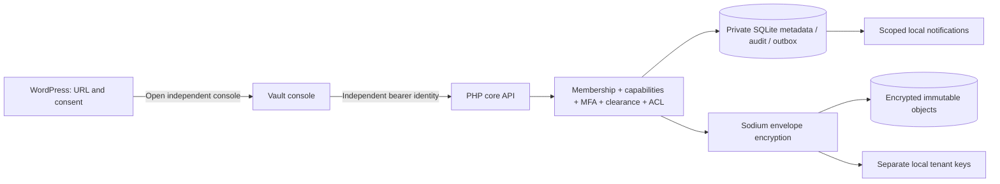

# SubsidiaryVault KMS

**Enterprise Document & Knowledge Management for WordPress**

SubsidiaryVault separates organizational document access from WordPress administration. An independently authenticated service controls subsidiary memberships, document permissions, encrypted versions and governance. WordPress supplies a small connector for navigation and connection settings.

**Status: `0.1.0-dev` — incomplete local development implementation. Use synthetic data only.** This repository contains working, tested software, but it does **not** implement the entire 346-requirement enterprise product. Production deployment and high-assurance zero-knowledge repository access are unavailable. [Readiness](docs/release/READINESS.md) and [feature coverage](docs/requirements/feature-coverage.md) describe the exact limits.

## Contents

- [Working capabilities and scope](#working-capabilities-and-scope)
- [Quick start](#quick-start)
- [Architecture and security modes](#architecture-and-security-modes)
- [Repository structure](#repository-structure)
- [Using the workspace](#using-the-workspace)
- [WordPress connector](#wordpress-connector)
- [Configuration and limits](#configuration-and-limits)
- [API and workers](#api-and-workers)
- [Offline file utility and backups](#offline-file-utility-and-backups)
- [Languages and accessibility](#languages-and-accessibility)
- [Verification and packaging](#verification-and-packaging)
- [Requirements, sources and remaining work](#requirements-sources-and-remaining-work)
- [Operations, contribution, support and license](#operations-contribution-support-and-license)

## Working capabilities and scope

The local application provides:

- Ten seeded subsidiaries with independent memberships, eight synthetic identities each and a separate holding governor.
- Current-membership checks, tenant capabilities, classification clearance and user/group/role document ACLs. Explicit denials win; privileged actions require session MFA. WordPress administrators gain no document rights.
- Tenant custom roles, static teams, department hierarchies, eligible settings, quotas, idempotent provisioning and audited suspension/reactivation.
- UTF-8 text documents and knowledge articles, encrypted immutable content versions, separate metadata revisions, permission-filtered title/metadata search, comments and bookmarks.
- Version-bound reviews with separate approvers; immutable record declaration; legal holds and dual-officer release; monotonic retention; separate disposition approval before soft deletion.
- Local hash-linked audit, transactional outbox and current-authorized local inbox notifications.
- An independent browser console, installable WordPress connector, unsigned offline file-encryption utility, encrypted snapshots and isolated restoration.
- Draft navigation/status translations for 13 languages, Persian/Arabic direction handling, reproducible tests and requirement tracking.

These are partial implementations of broader canonical features. Binary formats, resumable uploads, actual antivirus/quarantine, folders/libraries, rich coauthoring, full workflow design, external sharing/data rooms, cloud integrations, AI, native/mobile clients, full migration tools and specialized enterprise modules remain unfinished. PostgreSQL/RLS, private object storage, KMS/HSM, complete identity federation and independent immutable audit are also not implemented production adapters. See the [gap register](docs/requirements/gap-register.md).

## Quick start

Prerequisites:

| Tool | Requirement |
|---|---|
| PHP CLI | 8.3+ with `pdo_sqlite`, `sodium`, `openssl`, `intl`, `mbstring` and `Phar` |
| Python | 3.10+ for verification/build tools |
| Node.js | For JavaScript syntax verification; no npm installation is needed |
| Make | Optional convenience targets; commands can be run individually |

No Composer or npm dependencies are required. The executed host environment was PHP 8.5.8, Python 3.14.5 and Node.js 26.12.0 on macOS ARM64. Other runtime versions are not claimed as locally tested.

From the repository root:

```sh
make setup
make serve
```

Open **http://127.0.0.1:8088**. In another terminal:

```sh
php tools/vault.php token tenant-01-custodian
```

Paste that synthetic token into the console and open the workspace. Decline browser password saving. Application tokens remain in page memory; refreshing requires signing in again.

Without Make:

```sh
php tools/vault.php migrate
php tools/vault.php seed
php -S 127.0.0.1:8088 -t services/core-api/public services/core-api/public/router.php
```

Setup creates ignored private data under `var/data` and separate tenant keys under `var/keys`. Raw synthetic credentials are written to the private, ignored `var/data/demo-credentials.json`; the database stores token hashes. Seeded tokens expire after eight hours. Running setup again preserves existing identities, keys and documents. To replace development sessions without deleting data:

```sh
php tools/vault.php rotate-demo-tokens
```

The built-in server binds loopback and is for development. Do not expose it publicly or upload company data. A managed environment may require permission to bind a local socket.

An optional [Docker development composition](infrastructure/dev/compose.yaml) is supplied:

```sh
docker compose -f infrastructure/dev/compose.yaml up --build
docker compose -f infrastructure/dev/compose.yaml exec vault php tools/vault.php token tenant-01-custodian
```

Docker build/runtime was **not tested** here because daemon access was unavailable. This composition uses local SQLite/key volumes and a mutable development image tag; it is not the enterprise deployment architecture.

## Architecture and security modes



The WordPress connector stores no vault credentials, documents or decryption keys, performs no automatic remote requests and cannot impersonate vault users. It opens the independently served console in a new tab. WordPress cookies, roles and nonces are not accepted as vault authentication.

Every core operation verifies independent identity and current membership. Resource access also checks tenant ownership, capability, classification, document ACL and explicit denials; relevant operations add MFA, preservation and separation-of-duties checks. SQLite transactions serialize local authorization/state changes, and document updates commit with audit evidence. Content and metadata have separate revision checks. Workers and inbox delivery reauthorize current access.

| Profile | Current state | Trust and limits |
|---|---|---|
| Managed local | Implemented for synthetic UTF-8 text | Service can see authorized plaintext and metadata. Fresh per-version keys and authenticated context; tenant keys are readable by the local service. This is not KMS/HSM-backed protection. |
| Managed enterprise | Not implemented | Requires approved identity, PostgreSQL/RLS, private objects, KMS/HSM, workload policies, independent audit and operational validation. |
| High-assurance zero-knowledge vault | Unavailable; mode requests rejected | Requires reviewed recipient/device/recovery protocol and independently authenticated, signed client/update distribution. A WordPress-origin decrypting page does not satisfy this boundary. |
| Offline file utility | Implemented, unsigned development tool | Uses Sodium secretstream with a separately held file key; has no vault enrollment, verified recipient sharing, keychain or signed update integration. It is not the missing high-assurance client. |

Local audit chains and SQLite immutability triggers protect normal application paths; root/database administrators can defeat them. Record/hold guards are not production WORM storage. Previously downloaded plaintext cannot be recalled. No zero-vulnerability, certification, legal-compliance or production-readiness claim is made.

Read the [architecture](docs/architecture/overview.md), [threat model](docs/security/threat-model.md), [cryptographic profile](docs/security/crypto-profile.md), [privacy inventory](docs/privacy/data-inventory.md) and [22 internal decisions](docs/requirements/decision-log.md) before extending security-sensitive behavior.

## Repository structure

```text
apps/
  admin-web/                  Independent HTML/CSS/JavaScript console
  trusted-vault-client/       Unsigned offline PHP/Sodium file utility
  wordpress-plugin/
    subsidiaryvault-kms/      Installable WordPress connector
services/core-api/
  src/                        Authentication, policy, encryption, audit, API
  public/router.php           HTTP boundary and explicit console-asset allowlist
  migrations/                 Ordered SQLite migrations (current schema: 3)
packages/
  contracts/openapi.json      Reference for 42 paths / 67 implemented operations
  crypto-test-vectors/        Upstream primitive-vector provenance
  i18n/                      Draft catalogs and WordPress locale mappings
infrastructure/
  dev/                        Untested local Docker recipe
  production/                 Explicit production prerequisites and gate
tests/                        Domain/security, HTTP, connector, crypto/recovery tests
tools/                        Setup, worker, snapshot/restore, lint, registry, package
docs/
  source/                     Six preserved originals, extracted text and hashes
  requirements/               All 346 contracts, status and compatibility matrices
  decisions/                  D-01 through D-22
  architecture/ security/     Boundaries, references and cryptographic limitations
  privacy/ operations/       Processing inventory and operational/user guides
  implementation/ release/   Persistent progress, executed tests and release gates
.github/workflows/ci.yml      Proposed correctness matrix; not executed here
var/                         Ignored private runtime data and keys
dist/                        Ignored reproducible plugin ZIP and checksum
```

## Using the workspace

Tenant IDs are `tenant-01` through `tenant-10`. Obtain each user's token with `php tools/vault.php token USER_ID`.

| User ID example | Development role |
|---|---|
| `tenant-01-administrator` | Local settings/membership/role administration, without automatic document access |
| `tenant-01-custodian` | Seeded document owner, version creation, access grants and permitted governance |
| `tenant-01-reviewer` | Granted viewing/download/comment and independent approval |
| `tenant-01-records`, `tenant-01-records2` | Granted records/hold/disposition operations; separate officers for dual control |
| `tenant-01-viewer` | View granted metadata; download is denied |
| `tenant-01-contributor` | Create own content and edit explicitly granted materials |
| `tenant-01-lowclearance` | Classification-denial demonstration |
| `holding-governor` | Aggregate oversight, provisioning and suspension/reactivation; no subsidiary document access |

Create a document or knowledge article with a title, classification, category and UTF-8 content. Every new content version receives a fresh encrypted object. Metadata changes increment an independent revision. Search considers current-authorized titles and metadata, not file content. Document dialogs expose only effective actions; the server enforces those same checks independently.

A review example:

1. Sign in as the custodian and submit the seeded version for approval.
2. Sign out, sign in as that subsidiary's reviewer, and approve or reject the pinned version.
3. A permitted records officer can declare an approved version an immutable record. An owner, author or requester cannot approve their own version.

For preservation, one authorized officer places a hold and another releases it. Retention can only be extended. A non-record may be soft-deleted only after a separate disposition approval and another current preservation check. No purge/key-destruction, record-unlock or recycle restoration endpoint exists.

See the [full local/user guide](docs/operations/local-development.md) for detailed workflows, fixture roles, tokens and operational caveats. All 26 specification personas are retained in the [permission matrix](docs/requirements/permission-matrix.csv); they are not all configured as complete runtime role templates.

## WordPress connector

```sh
make package
```

Install `dist/subsidiaryvault-kms-0.1.0.zip` through WordPress Plugins → Add New → Upload Plugin, or copy `apps/wordpress-plugin/subsidiaryvault-kms` into `wp-content/plugins`. Activate, open **SubsidiaryVault → Connection settings**, configure the independent HTTPS console URL and acknowledge the external-service disclosure.

Only the URL and consent boolean are stored. Settings and connection diagnostics require `manage_options`; navigation requires `read`. The connector uses the Settings API, escaping/sanitization and an explicit REST permission callback. Uninstall removes only its WordPress option, without altering independent vault data.

An explicit disposable-development exception permits HTTP loopback URLs only when both `WP_DEBUG` and `SVKMS_ALLOW_LOCAL_CONSOLE` are true. Credential-bearing URLs, query strings and fragments are rejected. Never paste vault tokens or keys into WordPress.

Compatibility metadata targets WordPress 6.8+ and PHP 8.3+. Local syntax, connector-logic harness and ZIP checks passed; live WordPress activation/uninstall, REST/nonces, multisite, Plugin Check and WPCS have not run. There is no claimed WordPress.org approval or signed updater. Read the [connector guide](docs/operations/wordpress.md) and packaged [readme](apps/wordpress-plugin/subsidiaryvault-kms/readme.txt).

## Configuration and limits

Export environment variables in the invoking process. [.env.example](.env.example) is documentation; no dotenv loader is bundled.

| Variable | Default / purpose |
|---|---|
| `SV_ENV` | `local`; all other values reject startup |
| `SV_DATA_DIR` | `<repository>/var/data`; private SQLite, encrypted objects and synthetic credentials |
| `SV_KEY_DIR` | `<repository>/var/keys`; separate private tenant-key directory |
| `SV_AUTH_MODE` | `development` or experimental `oidc-rs256` |
| `SV_OIDC_ISSUER` | Exact independent issuer for the experimental verifier |
| `SV_OIDC_AUDIENCE` | Exact intended API audience |
| `SV_OIDC_PUBLIC_KEY` | Path to pinned RSA public-key PEM, never a private key |

The RS256 adapter accepts only independently pre-provisioned users. It has no complete browser federation, JWK rotation, provider provisioning, refresh/logout, SAML or SCIM. Provider MFA claims are deliberately not trusted until configured, so step-up operations remain denied through this adapter.

Local limits: **8 MiB/version**, nonempty UTF-8 text without prohibited control bytes; **12 MiB HTTP JSON envelope**; **100 MiB default tenant quota**, configurable between 1 MiB and 1 GiB; **120 requests/principal/tenant/minute**. Quota accounting includes every retained historical/soft-deleted version. An EICAR marker is rejected, but that is not an antivirus scanner. No binary uploads, resumable uploads or preview conversions are available.

Encryption, explicit-deny precedence, privileged MFA and audit cannot be disabled in tenant settings. AI/external sharing cannot be enabled. Geographic residency, legal schedules, real providers and operational authorities are not inferred from `local`, the developer machine or the source documents.

## API and workers

The [API guide](docs/operations/api.md) documents authentication, request bodies, errors, revision checks and operation semantics; [OpenAPI JSON](packages/contracts/openapi.json) describes current routes with generic success schemas. A complete typed SDK is not supplied.

Protected calls require an independent bearer header. Public liveness is `/healthz`. Private filesystem paths are never served, and private responses use no-store/noindex/frame/CSP headers. There is no WordPress-cookie authority or CORS grant.

```sh
php tools/worker.php
php tools/vault.php audit
php tools/diagnostics.php
```

Each worker invocation processes at most 100 outbox events. Run repeatedly until zero events remain. It writes local inbox notifications only, authorizes recipients against current state and uses deterministic IDs for retries. Inbox reads recheck access after revocation. No external emails, chat messages or webhooks are sent. Diagnostics report runtime/extension/schema information without document contents, tokens, keys or private paths.

Audit events describe application authorization and service operations. They do not prove a person read a document or finished saving a download. An independent immutable sink, trustworthy timestamps and protected external checkpoints remain required.

## Offline file utility and backups

The unsigned local file utility has no network connection or repository identity integration:

```sh
php apps/trusted-vault-client/vault-client.php keygen /private/tmp/svkms-file.key
php apps/trusted-vault-client/vault-client.php encrypt input.txt output.svenc --key /private/tmp/svkms-file.key example-context
php apps/trusted-vault-client/vault-client.php decrypt output.svenc restored.txt --key /private/tmp/svkms-file.key example-context
```

Use new private paths; existing outputs are refused. Decryption requires the exact same key and context and publishes only after complete stream authentication. Keep keys separately from ciphertext. This utility does not provide verified recipients, enterprise recovery or signed native-client assurance.

Encrypted local backup and isolated restoration:

```sh
php apps/trusted-vault-client/vault-client.php keygen /private/tmp/svkms-backup.key
php tools/backup.php /private/tmp/svkms-backup.key /private/tmp/svkms-snapshot.svbackup
php tools/restore.php /private/tmp/svkms-backup.key /private/tmp/svkms-snapshot.svbackup /private/tmp/svkms-isolated-restore
```

Backups include a consistent metadata snapshot, referenced encrypted objects and an authenticated integrity manifest. **Tenant encryption keys are omitted and need separate protected backups.** Old sessions are revoked in snapshots and restores. Restore refuses existing destinations and produces an isolated directory. Before any reconnection, current identities, revocations, ACLs, legal holds and retention must be reconciled; that reconciliation is not automated. No immutable/offline provider or RTO/RPO promise is supplied. Follow the [backup/recovery guide](docs/operations/backup-recovery.md).

## Languages and accessibility

Draft navigation/status catalogs cover English, Persian, French, Turkish, Russian, Simplified Chinese, German, Portuguese, Spanish, Hindi, Japanese, Arabic and Armenian. Catalog codes are `en`, `fa`, `fr`, `tr`, `ru`, `zh-Hans`, `de`, `pt`, `es`, `hi`, `ja`, `ar`, `hy`; Portuguese defaults to `pt-PT`. [Locale mappings](packages/i18n/locales.json) include corresponding WordPress locales.

Persian and Arabic select RTL logical layouts. Tables use bidirectional isolates for dynamic values and dates use `Intl.DateTimeFormat`. Semantic labels, a skip link, focus indicators and reduced-motion handling are present. Desktop English and Persian layout/document forms were inspected in actual browsers. **Forms, notices and errors remain partly English.** Complete translation, native terminology review, Arabic/mobile journeys, screen readers, keyboard workflows and independent WCAG 2.2 AA acceptance are unfinished. No translation certification or accessibility-conformance claim is made.

Rebuild draft catalogs with `python3 tools/build_locales.py`; do not represent key parity as complete language coverage.

## Verification and packaging

```sh
make validate
make package
python3 tools/release_gate.py --development
```

The executed validation passed **1,154 automated assertions**:

| Suite | Actual result |
|---|---:|
| Domain, policy, tenant/security and identity checks | 21 groups / 1,058 assertions |
| WordPress connector API harness | 11 assertions |
| Crypto, outbox and isolated recovery | 62 assertions |
| Real loopback HTTP boundary | 23 assertions |

Syntax checks passed for 23 PHP files and console JavaScript. Registry validation confirms all 346 contracts, expected 22 module counts, source hashes/equality, 26 personas, 22 ADRs and 13 draft catalog keys. Tests use disposable private fixtures. Primitive checks use a public upstream Sodium known-answer vector; that does not certify the application protocol. See [executed results and unperformed checks](docs/implementation/TEST-RESULTS.md).

`dist/subsidiaryvault-kms-0.1.0.zip` is generated with deterministic timestamps and `dist/SHA256SUMS`. The development package gate verifies scope and excludes secret/runtime files. The GitHub Actions definition proposes PHP 8.3–8.5 correctness jobs, but that remote matrix has not executed here and is not a complete security-scan/provenance pipeline.

```sh
python3 tools/release_gate.py
```

This command **intentionally exits 1** and denies production release. Passing local tests does not satisfy missing engineering, independent assessments or accountable human approval.

## Requirements, sources and remaining work

All six supplied originals, extracted DOCX/XLSX text and checksums are preserved under [docs/source](docs/source/REVIEW.md). The immutable [canonical JSON](docs/requirements/canonical-requirements.json) contains **346 features in 22 modules**. The master also describes 44 specialist delivery functions, 26 runtime personas and 22 architecture questions; these are not 44 actual independent reviewers or signed human approvals.

Current complete-contract status:

| Status | Requirements |
|---|---:|
| `IN_PROGRESS` — working components, incomplete full acceptance | 109 |
| `NOT_STARTED` | 234 |
| `BLOCKED` — outside dependency plus disclosed unfinished work | 3 |
| `VERIFIED` / `IMPLEMENTED_UNVERIFIED` / `DEFERRED` | 0 / 0 / 0 |

The entire product remains incomplete. Component tests do not promote a partially addressed contract to full `VERIFIED` status.

| Module | Scope | Requirements |
|---|---|---:|
| TEN | Holding structure and tenant isolation | 14 |
| IAM | Membership, roles and authorization | 17 |
| AUT | Authentication, sessions and trusted devices | 13 |
| DOC | Document capture, storage and lifecycle | 22 |
| MET | Metadata, taxonomy and discovery | 16 |
| COL | Editing, collaboration and versioning | 16 |
| KNO | Knowledge, wiki and learning | 16 |
| WFL | Workflows and approvals | 19 |
| REC | Records, retention, holds and discovery | 18 |
| ENC | Encryption, keys and zero-knowledge | 20 |
| SEC | Threat defense and DLP | 16 |
| EXT | External collaboration and exchange | 13 |
| RPT | Audit, reporting and oversight | 14 |
| AIX | Privacy-aware optional AI | 17 |
| L10 | Languages and accessibility | 15 |
| API | APIs, connectors and interoperability | 17 |
| UX | Productivity and workspace experience | 13 |
| MOB | Mobile, desktop and offline | 12 |
| PRV | Privacy, compliance and residency | 14 |
| OPS | Reliability, deployment and quality | 21 |
| MIG | Migration, onboarding and support | 13 |
| VRP | Specialized enterprise modules | 10 |

Project records:

- [Traceability: every feature, status, partial code/evidence and residual risk](docs/requirements/traceability.csv)
- [Module coverage](docs/requirements/feature-coverage.md), [mode compatibility](docs/requirements/mode-compatibility.csv), [persona/action matrix](docs/requirements/permission-matrix.csv) and [compliance uncertainty](docs/requirements/compliance-matrix.csv)
- [Gap register](docs/requirements/gap-register.md), [risk register](docs/requirements/risk-register.md) and [internal ADRs](docs/requirements/decision-log.md)
- [Persistent progress and resume point](docs/implementation/PROGRESS.md), [release gates](docs/release/READINESS.md) and [production prerequisites](infrastructure/production/README.md)

The next core work is complete independent identity provisioning/login/session/step-up integration and managed production adapters, followed by folder-scoped lifecycle, scanner/quarantine, metadata schemas and broader workflow/records functionality. High-assurance client development requires a public protocol, verified recipient/device identity, signing/update custody and qualified external review. Enterprise expansion must implement the remaining unchanged contracts rather than add placeholder controls.

No real cloud account, provider, legal jurisdiction, domain, signing authority, trademark clearance, privacy approval or production deployment has been assumed. Independent human security, cryptographic, legal/privacy, records, accessibility, UAT and disaster-recovery evidence is still required.

## Operations, contribution, support and license

Operational documentation: [local/user guide](docs/operations/local-development.md), [API guide](docs/operations/api.md), [WordPress](docs/operations/wordpress.md), [backup/recovery](docs/operations/backup-recovery.md), [incident/support runbook](docs/operations/incident-response.md) and [processing inventory](docs/privacy/data-inventory.md).

Troubleshooting:

| Symptom | Check |
|---|---|
| `invalid_session` | Token expired, was rotated/revoked, or belongs to another test database; obtain a current synthetic token. |
| Empty document list / `acl_denied` | Current membership, classification and explicit document ACL; administrator status alone is insufficient. |
| `step_up_required` | Use an appropriately assured synthetic privileged identity; unconfigured IdP MFA claims are intentionally untrusted. |
| `version_conflict` / `metadata_revision_conflict` | Reload current metadata/version before retrying; do not overwrite another change. |
| `preservation_required` / disposition conflict | Respect holds, record locks, retention and separate approvals; never bypass them to remove an error. |
| `key_unavailable` / integrity error | Stop the affected operation, preserve evidence and follow recovery; do not generate replacement keys over originals. |
| Empty inbox | Run the bounded worker to drain events, and confirm current document access. |
| Bind failure / port in use | Verify loopback socket permission or choose another local port in the serve command. |

Follow [CONTRIBUTING.md](CONTRIBUTING.md): preserve canonical contracts, add forward migrations and meaningful denial/preservation tests, document actual evidence, and keep credentials, keys, snapshots and real content out of Git. Never equate self-review with external approval. Changes and current release scope are in [CHANGELOG.md](CHANGELOG.md).

For non-sensitive defects, use the repository issue tracker with a synthetic reproduction. A verified private security contact, production support SLA and named maintainer roster have not been supplied; the owner must configure them before real use. See [SECURITY.md](SECURITY.md). Do not publish tokens, keys, company documents or unredacted diagnostics in reports.

Source is distributed under **GPL-2.0-or-later**; see [LICENSE](LICENSE). The WordPress ZIP includes the license. PHP/Sodium and other installed system components retain their respective upstream licenses; no third-party package source is vendored here.

This README was structured after researching [GitHub's README guidance](https://docs.github.com/en/repositories/managing-your-repositorys-settings-and-features/customizing-your-repository/about-readmes) and [Google's documentation guide](https://google.github.io/styleguide/docguide/READMEs.html), then checked against the implemented repository and executed commands. Additional primary-source engineering references are recorded in [research notes](docs/architecture/references.md).
