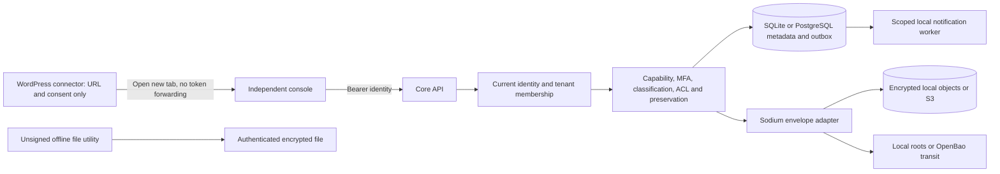

# Architecture and implemented boundary

The console is served by the independent PHP service, never by WordPress. In this local profile the management service may see authorized document plaintext; it is not a high-assurance zero-knowledge client. The separate offline utility has no network or vault identity integration and is not represented as that missing client.

`Application` dispatches a versioned API inside `BEGIN IMMEDIATE` SQLite transactions or PostgreSQL transactions with a global advisory lock and transaction-local principal/tenant RLS context. Forced RLS runs under a non-owner, non-superuser, non-BYPASSRLS runtime identity in the real fixture. RLS does not replace application policy or resist a compromised service choosing arbitrary context. Authentication, tenant membership and policy are evaluated during the transaction; mutations and their audit event commit together. A failed request rolls back its mutation and writes a minimal denial event separately. If denial audit cannot be written, the request returns unavailable. Local files written by failed mutations are removed; remote encrypted S3 orphans remain for preservation-aware reconciliation. A crash between object publication and DB commit can leave an orphan encrypted file; no automatic purge exists because preservation review is required.

`Policy` requires active identity, active and unexpired membership, tenant capabilities, privileged MFA, tenant ownership and classification clearance. Document actions also require a matching unexpired user/group/role ACL. Explicit deny overrides any allow. Holding and subsidiary administrators receive no automatic content ACLs. Custom roles start empty; a manager cannot amplify capabilities or change their own membership. Individual document sharing cannot grant the actor access or exceed their existing resource authority. There is no emergency bypass.

All document versions are immutable rows and newly encrypted files. `expected_version` rejects stale content writes; metadata changes additionally require `expected_metadata_revision` and increment that independent counter, preventing lost metadata updates. Approval locks a particular version, forbids owner/author/requester self-approval and records MFA, digest, decision/comment, time and policy revision. Database triggers protect approved decision evidence, records, holds and monotonic retention. Physical deletion, object-lock storage, cross-subsidiary sharing and legal discovery exports are absent.

Metadata, relationships, titles, comments, access rules and minimal audit events live outside WordPress in the configured metadata database. Per-version data keys are wrapped under a tenant key; the wrapped envelope lives alongside version metadata. Object paths are opaque random identifiers, obtained through a tenant-scoped DB lookup. A direct path is never a repository permission. Local mode reads file roots; external mode unwraps DEKs using a restricted non-exportable transit root. The service sees authorized plaintext in both modes, so full decrypting-service compromise defeats managed confidentiality.

The local audit chain is append-only through application/SQLite triggers and hash-linked per tenant. A filesystem/DB administrator can remove triggers, rewrite the chain or truncate a suffix. Ed25519 checkpoint tooling now binds an independently trusted tenant prefix and detects prefix rewrite/truncation. Independent latest-checkpoint custody, immutable sink/scheduling, SIEM, external timestamps and privileged storage controls remain enterprise work.

The outbox worker processes at most 100 events per invocation in a transaction, reevaluates current view permissions for each recipient, writes deterministic notification IDs and advances the checkpoint atomically. Inbox reads reauthorize each document. No external email/webhook is sent. See the API reference and operational runbooks for actual supported paths.

Independent OIDC code/PKCE, live introspection and exact issuer/subject binding are optional managed reference adapters. Only approved exact ACR plus recent authentication can map privileged MFA; real privileged flow acceptance is unfinished. [Self-hosted reference topology](../operations/self-hosted-reference.md) documents tested service boundaries, no implicit migration, outage behavior and fixture limits.
